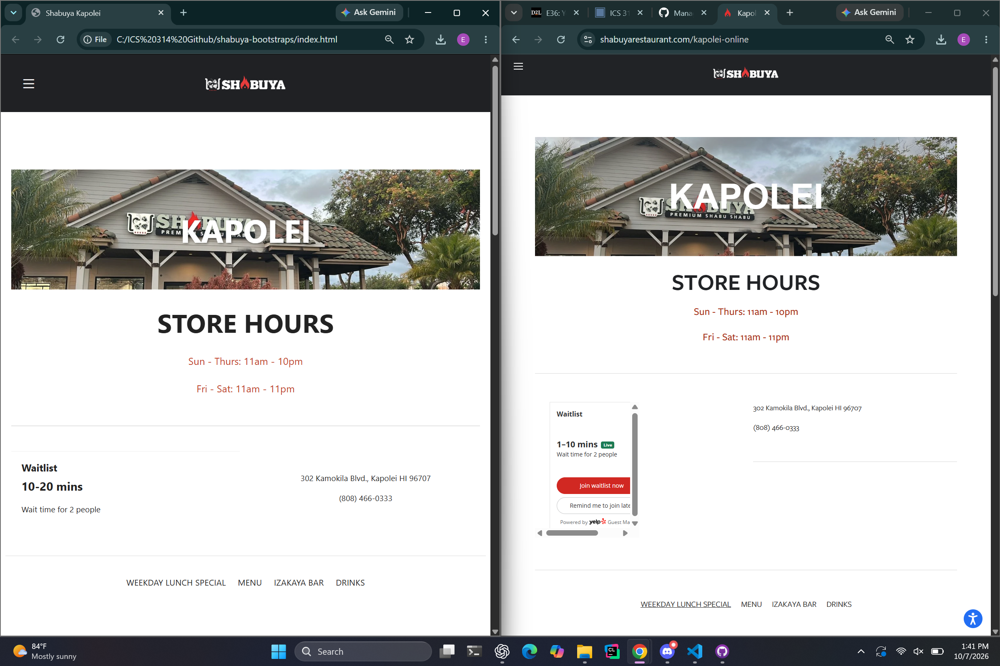

When I first started learning HTML and CSS, I thought making a website would be pretty simple. You write the HTML to organize everything, add some CSS to make it look nice, and the website should be finished. After working on a few websites, I started to realize that making everything look the way I wanted could take a lot more time than I expected. Sometimes I would spend more time adjusting images, spacing, and text than actually building the website. After learning about UI frameworks like Bootstrap 5, I started to understand why developers use them instead of writing everything from scratch.

## Why Use a UI Framework?

At first, I did not really understand why someone would want to learn another tool just to make a website. If HTML and CSS can already do everything needed to design a website, why bother learning Bootstrap?

After using Bootstrap more, I started to see how useful it could be.

Bootstrap provides prebuilt components and styles that developers can use instead of creating everything themselves. Things like buttons, navigation bars, and layouts can be made using classes that are already provided.

One of the biggest advantages is that it can save a lot of time.

For example, making a website look good on both a computer and a phone can take a lot of work with regular CSS. Bootstrap has a grid system that helps adjust the layout depending on the screen size.

Instead of spending so much time figuring out how to position everything, developers can focus more on the actual content and functionality of their website.

## My Experience With Bootstrap

One thing that made me appreciate UI frameworks more was working on websites using HTML and CSS.

When I worked on my browser history website, I spent a lot of time trying to get the layout, images, and text to look right. There were times when I would change something in the CSS, and it would fix one part of the website but make another part look different than I wanted.

I also experienced this when recreating the Shabuya Kapolei website using Bootstrap 5.

For this project, I tried to make my website look as close to the original as possible. I had to work on things like the navigation bar, images, text sizes, and spacing.

Even though Bootstrap helped with the layout, getting everything to look right still took several adjustments.

*My recreation of the Shabuya Kapolei website using Bootstrap 5 (left) compared to the original website (right).*

Sometimes changing one part of the layout would affect something else, and I would have to go back and fix it.

However, I started to understand how useful Bootstrap could be. Instead of writing CSS for every part of the website, I could use Bootstrap's existing classes to help organize the layout.

I also realized that Bootstrap does not completely replace HTML and CSS. I still needed to understand how everything worked to make the website look the way I wanted.

Looking at my finished website compared to the original, I think I was able to get them pretty close. This project helped me understand why developers use UI frameworks and how they can make building websites easier.

## Learning Bootstrap

Even though Bootstrap can make web development easier, I still think there is a learning curve.

There are a lot of different classes and components to understand. At first, it can feel like you are learning another language because you have to figure out what each class does and when to use it.

I think this can be frustrating, especially when you are already trying to learn HTML, CSS, and JavaScript.

However, I also think the time spent learning Bootstrap can be worth it.

Once you become familiar with the different classes, you do not have to keep figuring out how to style the same things over and over again.

It reminds me of using coding standards and tools like ESLint. At first, learning the rules can feel like extra work, but eventually those tools can make the development process more organized.

## The Downsides of Bootstrap

Even though Bootstrap has a lot of benefits, I do not think it is always the best choice for every website.

One problem is that websites using Bootstrap can sometimes look very similar. Since developers are using the same components, it can be harder to make a website look completely unique without adding custom CSS.

Another issue is that customizing certain components can become frustrating.

When I was recreating the Shabuya website, I still had to make several adjustments to get the layout to match the original. Bootstrap helped with the structure, but it did not automatically make everything look exactly how I wanted.

Sometimes it might actually be easier to write your own CSS instead of trying to figure out how to override Bootstrap's existing styles.

I also think Bootstrap might be unnecessary for a really simple website. If a website only has a few paragraphs, images, and links, adding an entire framework might be more complicated than just writing the HTML and CSS yourself.

For me, I think the important thing is knowing when a framework is useful and when it might just create more work.

## Why UI Frameworks Matter

I think one of the biggest benefits of UI frameworks is how they help with software engineering.

When multiple developers are working on the same website, it is important that everything looks consistent.

If everyone creates their own buttons, navigation bars, and layouts, the website could end up looking different depending on who worked on each section.

A framework like Bootstrap gives developers a common set of components and styles to work with.

This can also make websites easier to maintain. If developers are using the same framework and following the same design patterns, it becomes easier for someone else to understand the website and make changes later.

I think this is similar to why coding standards are important. Both help developers work more consistently and make projects easier to manage.

Instead of everyone doing things their own way, there is a common structure that makes working together easier.

## What I Learned

Before learning about UI frameworks, I probably would have said that writing your own HTML and CSS was the best way to build a website because you have complete control over everything.

Now I think UI frameworks can be useful because they save time and make it easier to build organized and responsive websites.

After working on my Shabuya website recreation, I can see how Bootstrap makes certain parts of web development easier. Even though I still had to spend time adjusting the design, having existing components and classes made the process more organized.

I still think learning HTML and CSS is important because a framework does not replace understanding how websites work.

Bootstrap might not be necessary for every project, but I can see why developers use it, especially when working on larger websites or with other people.

The biggest thing I learned is that web development is not always about writing everything yourself.

Sometimes using tools that other developers have already created can make your work easier and more efficient.

Going forward, I want to get more comfortable using Bootstrap while still improving my HTML and CSS skills. I think understanding both will help me become a better web developer.

## Use of AI

I used ChatGPT to help me write and organize a draft of this essay, improve the grammar and structure, and explain some of the advantages and disadvantages of Bootstrap and UI frameworks. I also used it to help describe my experience recreating the Shabuya Kapolei website using Bootstrap 5.
